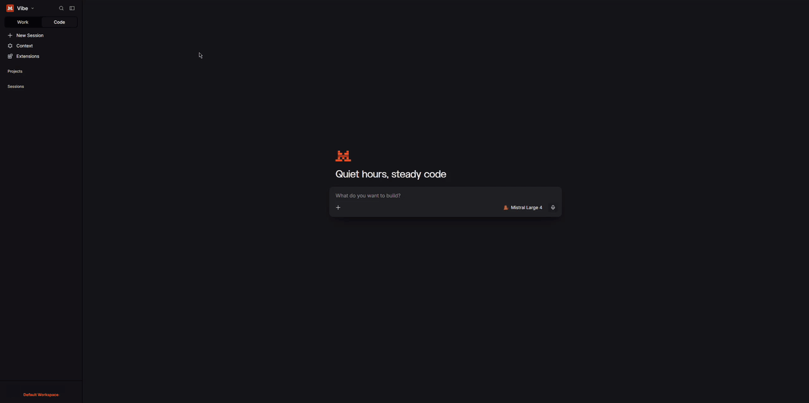
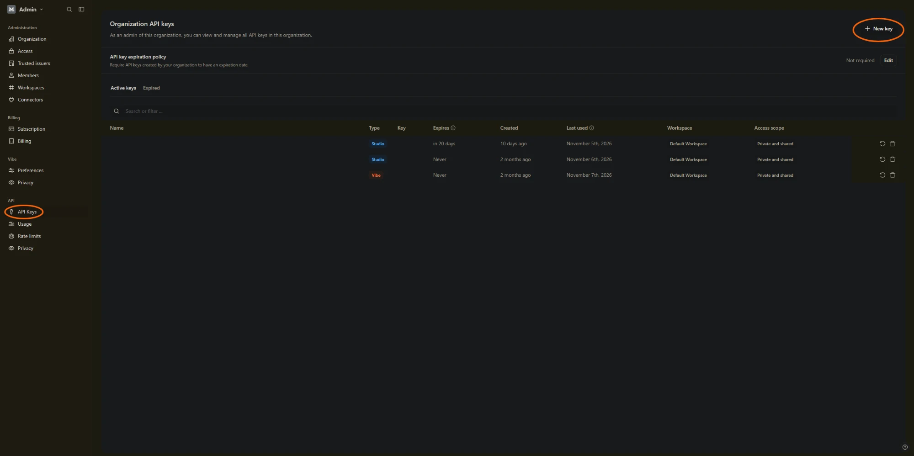

# mistral-gateway

A small local proxy that lets any OpenAI-compatible chat client (Open WebUI, editors, scripts) use the models included in your Mistral Vibe subscription. It is a single Python file with no dependencies beyond the standard library.

It uses the same key the official [Mistral Vibe CLI](https://github.com/mistralai/mistral-vibe) creates when you log in, sends requests to Mistral's public API and returns the answers in the exact shape OpenAI clients expect.

> **Unofficial project.** Not affiliated with, endorsed by or supported by Mistral AI. Read the "Terms of service" section below before using it.

## Setup

Requirements: Python 3.10+ and a Mistral Vibe plan with coding included (Pro, Team or Enterprise).

1. Get the gateway:

   ```sh
   git clone https://github.com/Classic298/mistral-gateway.git
   cd mistral-gateway
   ```

2. Get your Vibe key. There are two ways, pick one.

   **Option A: log in with the Vibe CLI.** Install the official Vibe CLI (see the [Mistral Vibe repository](https://github.com/mistralai/mistral-vibe) for other install methods) and log in with your Mistral account, picking the browser login in the setup wizard:

   ```sh
   curl -LsSf https://mistral.ai/vibe/install.sh | bash
   vibe --setup
   ```

   The CLI stores your plan key in `~/.vibe/.env`. The gateway reads it from there, so you never copy the key by hand.

   **Option B: copy it from the website.** No CLI needed. Open [Code › Extensions](https://chat.mistral.ai/code/extensions) in Vibe, expand **Advanced** on the Vibe CLI card and copy the **Vibe API Key**. The same panel shows your monthly usage and lets you rotate the key. Then create `gateway.env` next to `gateway.py`:

   ```sh
   VIBE_KEY=your-vibe-key
   ```

   

3. Optional: add a Studio API key as a fallback for when the Vibe key is rate limited or its monthly budget is spent. In the Mistral admin panel, open **API › API Keys** and click **New key**, then add it to `gateway.env`:

   ```sh
   STUDIO_API_KEY=your-studio-key
   ```

   

4. Start the gateway:

   ```sh
   python3 gateway.py
   ```

   It runs the same on Linux, macOS and Windows (on Windows the command is usually `py gateway.py`). Keep the terminal open while you use it, or see [Run it as a service](#run-it-as-a-service-linux-optional) on Linux.

   The log shows your plan name when the key works, and lists `studio` too if you added one:

   ```
   INFO vibe plan: ... (...)
   INFO mistral gateway on 127.0.0.1:8788 (keys: vibe)
   ```

5. Point your client at it:

   - Base URL: `http://127.0.0.1:8788/v1`
   - API key: anything (or the value of `GATEWAY_KEY` if you set one)
   - Model: any ID from `curl http://127.0.0.1:8788/v1/models`

   Requests must be sent as `Content-Type: application/json`. Browsers cannot call the gateway directly; it is meant for server-side and desktop clients.

   Quick test:

   ```sh
   curl http://127.0.0.1:8788/v1/chat/completions \
     -H "Content-Type: application/json" \
     -d '{"model": "mistral-small-latest", "messages": [{"role": "user", "content": "Hello"}]}'
   ```

### Open WebUI

1. Open **Settings** and pick **Connections** in the **Admin** part of the list (older versions: **Admin Panel › Settings › Connections**). Click ➕ (**Add Connection**) next to **Manage OpenAI API Connections**.
2. Enter the URL for your setup (pick the one that matches below). As the API key, enter your `GATEWAY_KEY` if you set one, otherwise any placeholder such as `none`.
3. Optional, but recommended: your plan includes dozens of models, including embedding, OCR and transcription models that cannot chat. In the same window, add only the ones you want under **Model IDs** (for example `zai-glm-5-3-flash`), so the model selector stays short. Leave it empty to get all of them.
4. Click **Save** and open the model selector. Your models show up there.

Which URL to use depends on how you run Open WebUI. Click the one that matches:

<details>
<summary><b>Open WebUI installed directly (pip, uv, Desktop app)</b></summary>

<br>

- URL: `http://127.0.0.1:8788/v1`
- API key: anything

</details>

<details>
<summary><b>Open WebUI in Docker with <code>--network host</code></b></summary>

<br>

The container shares the host's network, so the default setup works as is.

- URL: `http://127.0.0.1:8788/v1`
- API key: anything

</details>

<details>
<summary><b>Open WebUI in Docker on Linux (default network)</b></summary>

<br>

Inside the container, `127.0.0.1` is the container itself, so it cannot reach a gateway that only listens on the host's loopback. Let the gateway also listen on the Docker bridge, which only containers on this machine can reach, and protect it with a key.

1. Find the bridge address (usually `172.17.0.1`):

   ```sh
   ip -4 addr show docker0
   ```

2. Add to `gateway.env` and restart the gateway:

   ```sh
   BIND=172.17.0.1
   GATEWAY_KEY=pick-a-long-random-string
   ```

3. Start the Open WebUI container with `--add-host=host.docker.internal:host-gateway` (in Docker Compose: `extra_hosts: ["host.docker.internal:host-gateway"]`).
4. In Open WebUI:
   - URL: `http://host.docker.internal:8788/v1`
   - API key: your `GATEWAY_KEY`

Programs on the host then reach the gateway at `http://172.17.0.1:8788/v1` instead of `127.0.0.1`.

</details>

<details>
<summary><b>Open WebUI in Docker Desktop (macOS, Windows)</b></summary>

<br>

Docker Desktop forwards `host.docker.internal` to your computer's loopback, so the gateway can stay on `127.0.0.1`. It still needs a key, because it only answers other hostnames when `GATEWAY_KEY` is set.

1. Add to `gateway.env` and restart the gateway:

   ```sh
   GATEWAY_KEY=pick-a-long-random-string
   ```

2. In Open WebUI:
   - URL: `http://host.docker.internal:8788/v1`
   - API key: your `GATEWAY_KEY`

</details>

### Updating

```sh
cd mistral-gateway
git pull
```

Then restart the gateway (`systemctl --user restart mistral-gateway` if you run it as a service). Your `gateway.env` and `usage.db` are not touched by the update.

### Run it as a service (Linux, optional)

```sh
mkdir -p ~/.config/systemd/user
cp mistral-gateway.service.example ~/.config/systemd/user/mistral-gateway.service
# the example assumes the clone is at ~/mistral-gateway; otherwise edit WorkingDirectory and ExecStart
systemctl --user daemon-reload
systemctl --user enable --now mistral-gateway
journalctl --user -u mistral-gateway -f
```

## Models

Every model below was tested through the gateway with tool calls and every reasoning level. `/v1/models` always lists what your key can use.

| Model | Also available as | Context | Images | Reasoning effort |
|---|---|---|---|---|
| `mistral-large-4` | `mistral-large-4-0` | 1M | yes | `none`, `high` |
| `mistral-medium-latest` | `mistral-medium-3-5`, `mistral-medium-2604`, `mistral-vibe-cli-latest` | 256K | yes | `none`, `high` |
| `mistral-small-latest` | `mistral-small-2603`, `mistral-vibe-cli-fast` | 256K | yes | `none`, `high` |
| `zai-glm-5-3` | `zai-glm-latest`, `zai-glm-5` | 1M | no | `low`, `high`, `max` |
| `zai-glm-5-3-flash` | none | 1M | yes | `low`, `high`, `max` |
| `deepseek-v4-1-flash-1017` | none | 1M | no | `none`, `low`, `high`, `xhigh`, `max` |
| `mistral-large-latest` | `mistral-large-2512` | 256K | yes | no reasoning |
| `codestral-latest` | `codestral-2508` | 128K | no | no reasoning |
| `ministral-14b-latest` | `ministral-14b-2512` | 256K | yes | no reasoning |
| `ministral-8b-latest` | `ministral-8b-2512` | 256K | yes | no reasoning |
| `ministral-3b-latest` | `ministral-3b-2512` | 256K | yes | no reasoning |
| `voxtral-small-latest` | `voxtral-small-2507` | 32K | no | no reasoning |

All of them handle tool calls. Clients can send any standard `reasoning_effort` level to any model. When a model does not offer the requested level, the gateway uses the closest one it does offer, and on a tie `minimal` and `low` go down while everything else goes up: on Mistral Large 4, Medium and Small, `minimal` and `low` become `none` and the rest become `high`. Models without reasoning get the request without it. DeepSeek V4.1 Flash only thinks when the client sends a reasoning level. Mistral's docs list it as `deepseek-v4-flash-1017`, but the API only accepts `deepseek-v4-1-flash-1017`. Labs models such as `labs-leanstral-1-5` only answer once an admin enables Labs models in the organization settings. Embedding, OCR and transcription models are listed too, but the gateway only serves chat.

## Configuration

Settings come from environment variables or from a `gateway.env` file next to `gateway.py` (see `gateway.env.example`; `gateway.env` wins over the environment).

| Variable | Default | Meaning |
|---|---|---|
| `VIBE_KEY` | `MISTRAL_API_KEY` from `~/.vibe/.env` | Your Vibe plan key. Set it if you copied the key from Code › Extensions, or to override the CLI's file. |
| `VIBE_ENV_FILE` | `~/.vibe/.env` | Where to look for the Vibe CLI's key. |
| `STUDIO_API_KEY` | unset | Optional pay-as-you-go fallback key from Mistral AI Studio. |
| `GATEWAY_KEY` | unset | If set, clients must send it as `Authorization: Bearer <key>`. Without it the gateway only answers requests addressed to `localhost`, `127.0.0.1` or `[::1]`, so set it if a client reaches the gateway under another hostname (e.g. from a Docker container). |
| `BIND` | `127.0.0.1` | Listen address. Keep it on loopback (see below). |
| `PORT` | `8788` | Listen port. |
| `RETRY_429_SECONDS` / `RETRY_429_INTERVAL` | `60` / `10` | How long and how often to retry a rate-limited key. |
| `COOLDOWN_429` / `COOLDOWN_DEAD` | `60` / `21600` | Seconds a key is skipped after rate limiting / after 401 or 402. |
| `LOG_LEVEL` | `INFO` | Python logging level. |

Endpoints: `/v1/chat/completions`, `/v1/responses`, `/v1/models`, `/health`, `/pool/status` (which key is serving, cooldowns) and `/usage?days=N`.

## Terms of service

Checked against the [Mistral AI Terms of Service for EU consumers](https://legal.mistral.ai/terms/eu-consumers-terms-of-service) (effective August 7, 2026) and the [Mistral AI Commercial Terms of Service](https://legal.mistral.ai/terms/commercial-terms-of-service) (effective August 5, 2026). Consumers outside the EU have [separate terms](https://legal.mistral.ai/terms). This section is the author's reading of those documents and is **not legal advice**.

**Why the gateway is designed to stay within those terms:**

- **Official key, official API.** The key comes from Mistral's own login flow in the official Vibe CLI. The gateway calls the same public API endpoint with the same standard `Authorization: Bearer` header the CLI uses. It does not scrape, impersonate the CLI, reverse engineer anything or touch any security mechanism. Mistral's [API key documentation](https://docs.mistral.ai/admin/identity-access/api-keys) lists Vibe keys as "Keys used by Vibe Code" and states that "Vibe-only users usually do not need API keys unless they also use Studio, the API, Vibe Code, or another developer tool."
- **Your plan's limits stay in force.** Every request counts against your plan exactly like a Vibe CLI request. A rate limit makes the gateway wait and retry the same key; it never switches to another Vibe account to get around a limit. The only fallback is your own optional Studio key.
- **One person, one account.** The EU consumer terms state: "The creation or use of multiple Mistral AI accounts by a single individual is strictly prohibited, including to bypass rate limits or any other restrictions." The gateway therefore supports exactly one Vibe key.
- **Personal use only.** The consumer terms also state: "Your account is intended for your individual use only, and you may not share your account with any other person. [...] You may not make your account credentials available to third parties, [...] or resell or lease access to your account." The commercial terms (section 2.2) forbid customers to "buy, sell, or transfer API keys" and to "grant any third party access to the Mistral AI Products without our prior written authorization". The gateway therefore listens on `127.0.0.1` only. **Do not expose it to the internet or share it with other people**; doing so would hand them access to your account.

**Mistral has confirmed third-party use.** In a [stickied comment on the official r/MistralAI subreddit](https://www.reddit.com/r/MistralAI/comments/1ta8itv/comment/olccfnn/), a moderator with the Mistral team badge wrote: "you are currently able to freely use the Vibe key with any software, including Hermes and any other packages or third-party services. This has always been the case, meaning if you used the Vibe API key via third parties, the Vibe plan budget would be used first before any PAYG." In the same thread, the user who asked reports that Mistral support confirmed this and refunded the API charges they had been billed.

**Your responsibility.** Mistral can change its terms at any time. Before you use this gateway, and again whenever Mistral announces a change, read the current terms yourself and stop using the gateway if they no longer allow it. Mistral decides how to enforce its own terms, and nobody can promise that an account will not be restricted or suspended.

## Disclaimer

This software is provided "as is" under the [PolyForm Noncommercial License 1.0.0](LICENSE), without warranty of any kind. The author accepts no liability for any damage or loss arising from its use, including suspension, restriction or termination of your Mistral account, lost subscription fees or lost data.

## License

[PolyForm Noncommercial 1.0.0](LICENSE): free for personal, hobby, research and other noncommercial use. Commercial use is not permitted.

It is noncommercial because a Mistral Vibe subscription is a consumer plan: Mistral's consumer terms only cover "your personal use as a consumer", and business use falls under their separate [Commercial Terms of Service](https://legal.mistral.ai/terms/commercial-terms-of-service).

## What it does

- Serves `/v1/chat/completions`, `/v1/responses` and `/v1/models` on `127.0.0.1:8788` and passes them to Mistral's matching APIs.
- Fixes the places where Mistral's replies and accepted fields differ from OpenAI's, so reasoning, tool calls, token counts and long answers work in OpenAI clients.
- Swaps a reasoning level a model does not offer for the closest one it does.
- On a rate limit, retries the same key for up to 60 s. If the Vibe key stays rate limited or its budget is spent, it falls back to your Studio key if you set one.
- Records daily token usage per model, readable at `/usage`.

Mistral's Responses API keeps no history, so clients have to send the whole conversation each time.
